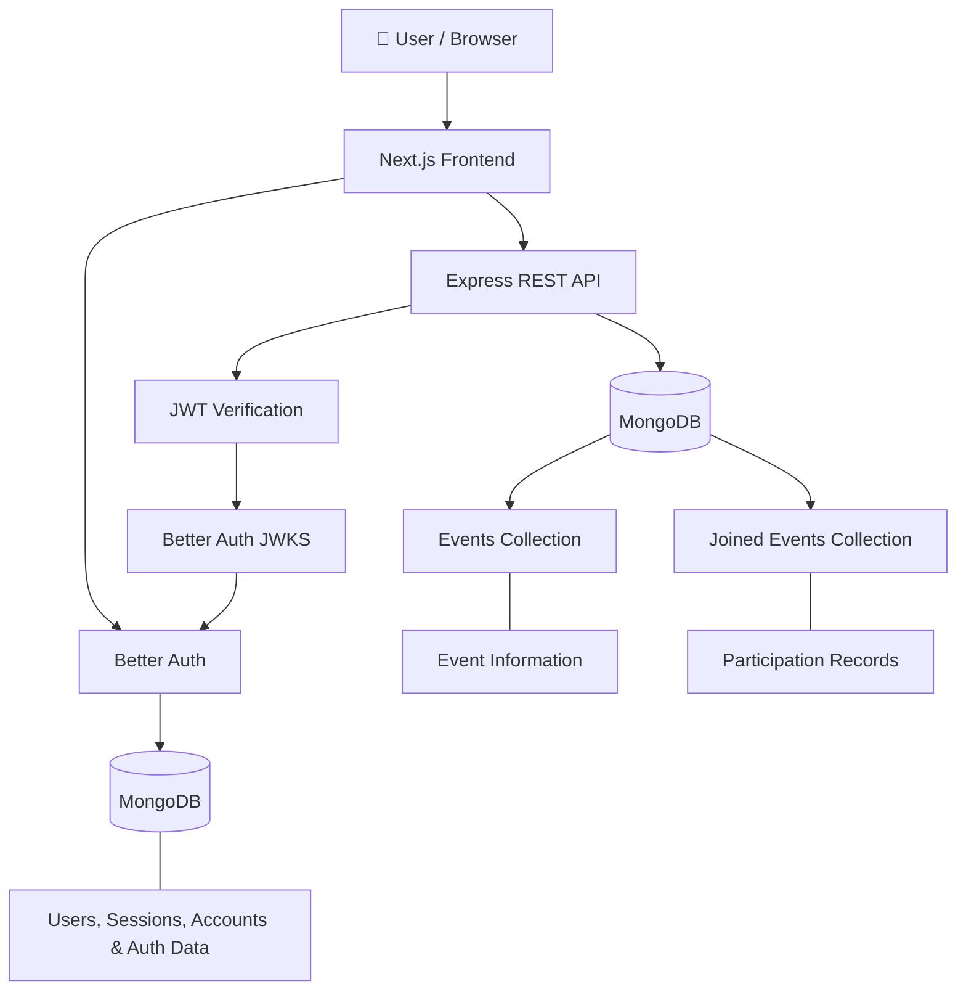

# 💛 BhaloBeat

### Every good deed has a pulse.

<p align="center">
  
</p>

<p align="center">
  <strong>Discover opportunities. Bring people together. Make a difference.</strong>
</p>

<p align="center">
  <a href="https://bhalobeat.vercel.app/"></a>
  <a href="https://github.com/tasdid-ahmed/bhalobeat"></a>
  <a href="https://github.com/tasdid-ahmed/bhalobeat-server"></a>
</p>

<p align="center">
  
  
  
  
  
  
  
</p>

---

## 🌱 About BhaloBeat

**BhaloBeat** is a community-driven platform designed to make volunteering and social initiatives easier to discover, organize, and participate in.

Whether it's organizing a neighborhood cleanup, planting trees, distributing food, supporting education, or arranging a donation drive, BhaloBeat gives people a shared space to turn good intentions into meaningful action.

The idea is simple: make it easier for people to find a cause, contribute their time, and bring their communities closer together.

> **Every good deed has a pulse.**  
> One event, one volunteer, and one positive action at a time.

<p align="center">
  
</p>

## ✨ What You Can Do With BhaloBeat

BhaloBeat brings together event discovery, community participation, and event management in one platform.

| Feature | Description |
|---|---|
| 📅 **Discover Events** | Explore upcoming community-service events and find opportunities to contribute. |
| ➕ **Create Events** | Organize a community initiative by publishing its details, location, date, category, and image. |
| ❤️ **Join Events** | Participate in events with a single action and keep track of your involvement. |
| 📋 **Manage Your Events** | View, update, and delete events you've organized. |
| 🤝 **Track Participation** | Access your joined events in one place, organized by event date. |
| 🔐 **Secure Authentication** | Register and sign in using email/password or Google authentication. |
| 👤 **Profile Management** | View and update your profile name and profile picture. |
| 🌗 **Dark & Light Themes** | Switch between light and dark appearances for a comfortable browsing experience. |
| 📱 **Responsive Interface** | Enjoy a layout designed to work across desktop, tablet, and mobile screens. |

### 🌍 Community Initiatives

BhaloBeat supports the following event categories:

- 🧹 Neighborhood Cleanup
- 🌳 Tree Plantation
- 🎁 Donation Drives
- 🍱 Food Distribution
- 🩸 Blood Donation
- 📚 Education Support
- 🏥 Health Camps
- 💛 Other Community Initiatives

## 🧭 Explore the Platform

| Page | Route | Purpose |
|---|---|---|
| 🏠 Home | `/` | Introduction, platform features, event highlights, and community gallery. |
| 📅 Upcoming Events | `/events` | Browse upcoming community events. |
| 🔎 Event Details | `/events/:id` | View an individual event and its participation option. |
| 🔑 Login | `/login` | Sign in using email/password or Google. |
| 📝 Register | `/register` | Create a BhaloBeat account. |
| ➕ Create Event | `/create-event` | Publish a new community event. |
| 📋 Manage Events | `/manage-events` | Update or delete events you've created. |
| ❤️ Joined Events | `/joined-events` | View events you've joined. |
| 👤 My Profile | `/profile` | View and update your profile information. |

*Authentication is required for account-specific pages and event-management actions.*

## 🛠️ Technology Stack

BhaloBeat uses a modern full-stack JavaScript ecosystem, with Next.js powering the frontend and a separate Express API handling event operations.

### Frontend

| Technology | Purpose |
|---|---|
| [Next.js 16](https://nextjs.org/) | React framework and application routing |
| [React 19](https://react.dev/) | Component-based user interface |
| [TypeScript](https://www.typescriptlang.org/) | Type safety and maintainable code |
| [Tailwind CSS 4](https://tailwindcss.com/) | Utility-first styling |
| [shadcn/ui](https://ui.shadcn.com/) | Reusable interface components |
| [Radix UI](https://www.radix-ui.com/) | Accessible UI primitives |
| [Lucide React](https://lucide.dev/) | Icons |
| [Sonner](https://sonner.emilkowal.ski/) | Toast notifications |
| [next-themes](https://github.com/pacocoursey/next-themes) | Theme management |

### Authentication & Database

| Technology | Purpose |
|---|---|
| [Better Auth](https://www.better-auth.com/) | Authentication, sessions, and JWT issuance |
| [MongoDB](https://www.mongodb.com/) | User, session, and application data storage |
| [JOSE](https://github.com/panva/jose) | JWT verification on the backend |

### Backend & Deployment

| Technology | Purpose |
|---|---|
| [Node.js](https://nodejs.org/) | JavaScript runtime |
| [Express 5](https://expressjs.com/) | Backend REST API |
| [Vercel](https://vercel.com/) | Frontend and backend deployment |
| [Git & GitHub](https://github.com/) | Version control and source-code management |

**Related repository:** [BhaloBeat Backend API](https://github.com/tasdid-ahmed/bhalobeat-server)

## 🏗️ Application Architecture

BhaloBeat separates the frontend, authentication system, and event API into distinct responsibilities.



### How Authentication Works

1. Users register or sign in through the Next.js application.
2. Better Auth manages authentication, sessions, and Google OAuth integration.
3. The Better Auth JWT plugin issues a signed token containing the user information needed by the API.
4. The frontend retrieves the token when making authenticated API requests.
5. The Express backend verifies the token using the Better Auth JWKS endpoint.
6. Once verified, the backend uses the authenticated identity to authorize the requested operation.

This separation allows the frontend to manage the user experience while the backend independently verifies authenticated API requests.

### API Communication

The frontend uses a centralized API utility rather than scattering fetch logic throughout the application.

- `api.ts` handles API URLs, requests, response parsing, and API errors.
- `auth-fetch.ts` obtains the Better Auth JWT and attaches it to protected requests.
- Public requests retrieve event information without authentication.
- Protected requests use the `Authorization: Bearer` header.

## 🎨 Design & User Experience

BhaloBeat aims to feel welcoming, accessible, and easy to use.

Some of the interface details include:

- A warm saffron-and-teal visual identity.
- A custom brand logo and community-focused hero section.
- Reusable event cards and form components.
- Clear loading skeletons while event data is retrieved.
- Empty states that guide users toward their next action.
- Toast notifications for important actions and errors.
- Accessible UI primitives and form validation.
- Responsive layouts and theme-aware components.

The interface uses **Plus Jakarta Sans** for headings and **Inter** for general text.

## 🚀 Getting Started

Want to run BhaloBeat locally? Follow these steps.

### Prerequisites

Make sure you have:

- [Node.js](https://nodejs.org/) installed.
- npm installed.
- A MongoDB database (MongoDB Atlas or a local MongoDB instance).
- Google OAuth credentials if you want to test Google sign-in.
- The BhaloBeat backend API running locally or access to the deployed API.

### 1. Clone the repository

```bash
git clone https://github.com/tasdid-ahmed/bhalobeat.git
```

### 2. Navigate to the project directory

```bash
cd bhalobeat
```

### 3. Install dependencies

```bash
npm install
```

### 4. Configure environment variables

Create a `.env` file in the project root.

Use `.env.example` as your reference:

```env
BETTER_AUTH_SECRET=your_secure_auth_secret
BETTER_AUTH_URL=http://localhost:3000

MONGODB_URI=your_mongodb_connection_string
DB_NAME=bhalobeat

GOOGLE_CLIENT_ID=your_google_client_id
GOOGLE_CLIENT_SECRET=your_google_client_secret

NEXT_PUBLIC_API_URL=http://localhost:5000
```

### Environment Variable Reference

| Variable | Description |
|---|---|
| `BETTER_AUTH_SECRET` | Secret used by Better Auth for cryptographic operations and JWT signing. |
| `BETTER_AUTH_URL` | Base URL of the frontend's Better Auth application. |
| `MONGODB_URI` | MongoDB connection string used by Better Auth. |
| `DB_NAME` | MongoDB database name. Defaults to `bhalobeat`. |
| `GOOGLE_CLIENT_ID` | Google OAuth client ID. |
| `GOOGLE_CLIENT_SECRET` | Google OAuth client secret. |
| `NEXT_PUBLIC_API_URL` | Base URL of the Express backend API, without the `/api` suffix. |

**Important configuration notes:**

- Use the same MongoDB cluster and database name for the frontend and backend so authentication and event data are available to the intended application.
- The frontend and backend must use compatible Better Auth JWT/JWKS configuration.
- `NEXT_PUBLIC_API_URL` is intentionally public because it is used by browser-side API requests. Never put private credentials in a `NEXT_PUBLIC_` variable.
- Keep `BETTER_AUTH_SECRET`, `GOOGLE_CLIENT_SECRET`, and `MONGODB_URI` private.
- Configure Google OAuth's authorized origins and callback settings to match your Better Auth deployment.
- Never commit your actual `.env` file to GitHub.

### 5. Start the development server

```bash
npm run dev
```

Open your browser:

```text
http://localhost:3000
```

The frontend will now run locally and communicate with the backend configured through `NEXT_PUBLIC_API_URL`.

### 6. Build for production

```bash
npm run build
```

### 7. Start the production server locally

```bash
npm start
```

This starts the compiled Next.js application.

## 📜 Available Scripts

| Command | Description |
|---|---|
| `npm run dev` | Start the Next.js development server. |
| `npm run build` | Create an optimized production build. |
| `npm start` | Start the production server. |
| `npm run lint` | Run ESLint to check code quality. |

## 🔒 Security & Data Protection

Security is an important part of BhaloBeat's architecture.

The frontend and backend work together to protect authenticated operations and user information.

Implemented safeguards include:

- Better Auth session management.
- Signed JWTs for authenticated API communication.
- Server-side JWT verification through JWKS.
- Server-side authorization and event ownership checks.
- Frontend and backend input validation.
- Safe handling of post-login redirect destinations.
- Restricted cross-origin API communication.
- Security-related HTTP response headers.
- Public event responses that avoid exposing creator email addresses.

**Important:** Frontend validation improves usability, but authorization and data validation are also enforced by the backend. The frontend is never treated as the authority for event ownership.

For more information about API routes, authentication verification, database collections, and backend configuration, visit the [BhaloBeat Backend Repository](https://github.com/tasdid-ahmed/bhalobeat-server).

## ☁️ Deployment

The production application is deployed on Vercel.

| Component | Deployment |
|---|---|
| 🌐 Frontend | [bhalobeat.vercel.app](https://bhalobeat.vercel.app/) |
| ⚙️ Backend API | [bhalobeat-api.vercel.app](https://bhalobeat-api.vercel.app/) |
| ❤️ API Health Check | [Check API Status](https://bhalobeat-api.vercel.app/api/health) |

### Production Configuration

When deploying the frontend:

1. Import the frontend repository into Vercel.
2. Configure the frontend environment variables.
3. Set `BETTER_AUTH_URL` to the deployed frontend URL.
4. Set `NEXT_PUBLIC_API_URL` to the deployed backend base URL.
5. Configure the Google OAuth application for the production domain.
6. Deploy the application.

The backend must also be configured with the correct frontend origin and compatible authentication settings.

**CORS configuration:** The backend's `CLIENT_URL` must match the frontend origin exactly. Avoid a trailing slash.

After deployment, verify that public event requests, authentication, and protected event-management operations work correctly.

## 📂 Project Structure

```text
bhalobeat/
│
├── public/
│   ├── gallery/
│   │   ├── blood-donation.png
│   │   ├── cleanup.png
│   │   ├── education.png
│   │   ├── food-distribution.png
│   │   ├── plantation.png
│   │   └── winter-clothes.png
│   │
│   ├── bhalobeat-logo.png
│   └── home-banner.png
│
├── src/
│   ├── app/
│   │   ├── api/
│   │   │   └── auth/
│   │   │       └── [...all]/
│   │   │
│   │   ├── create-event/
│   │   ├── events/
│   │   │   └── [id]/
│   │   ├── joined-events/
│   │   ├── login/
│   │   ├── manage-events/
│   │   ├── profile/
│   │   ├── register/
│   │   │
│   │   ├── globals.css
│   │   ├── icon.png
│   │   ├── layout.tsx
│   │   ├── not-found.tsx
│   │   └── page.tsx
│   │
│   ├── components/
│   │   ├── auth/
│   │   ├── events/
│   │   ├── home/
│   │   ├── profile/
│   │   ├── ui/
│   │   │
│   │   ├── footer.tsx
│   │   ├── navbar.tsx
│   │   ├── theme-provider.tsx
│   │   ├── theme-toggle.tsx
│   │   └── user-menu.tsx
│   │
│   └── lib/
│       ├── api.ts
│       ├── auth-client.ts
│       ├── auth-fetch.ts
│       ├── auth.ts
│       ├── constants.ts
│       ├── format.ts
│       ├── mongodb.ts
│       ├── session.ts
│       ├── utils.ts
│       └── validation.ts
│
├── .env.example
├── .gitignore
├── components.json
├── eslint.config.mjs
├── next.config.ts
├── package.json
├── package-lock.json
└── tsconfig.json
```

### Code Organization

| Directory | Responsibility |
|---|---|
| `src/app` | Next.js pages, layouts, metadata, and authentication API handler. |
| `src/components/auth` | Login, registration, Google sign-in, and reusable authentication forms. |
| `src/components/events` | Event cards, forms, joining, management, and loading states. |
| `src/components/home` | Homepage hero, feature highlights, gallery, and upcoming events. |
| `src/components/profile` | Profile management interface. |
| `src/components/ui` | Reusable interface primitives. |
| `src/lib` | Authentication configuration, API utilities, database connection, validation, and shared helpers. |
| `public` | Brand assets, homepage banner, and community gallery images. |

## 🗺️ What's Next?

BhaloBeat is designed as a foundation for bringing more people into community initiatives.

Potential future enhancements include:

- 🔎 Event search, filtering, and category-based discovery.
- 📍 Location-based event discovery.
- 🔔 Notifications for event updates and participation.
- 📧 A functional newsletter subscription service.
- 📊 Organizer dashboards and participation statistics.
- 🧪 Automated unit and integration testing.
- 📄 More comprehensive API documentation.

These are future possibilities, not claims about currently implemented features.

## 💛 The Idea Behind the Project

BhaloBeat is built around a simple belief: positive change becomes easier when people can find each other and work together.

A small neighborhood cleanup, a tree plantation drive, or a few hours spent helping children learn can make a meaningful difference.

The platform aims to make those opportunities easier to discover and easier to organize.

**Because every good deed deserves a place to begin.**

---

<p align="center">
  <strong>💛 BhaloBeat — Every good deed has a pulse.</strong>
  <br />
  <sub>Built with care, powered by community, and inspired by the people who make a difference.</sub>
</p>

<p align="center">
  <a href="https://bhalobeat.vercel.app/">Visit BhaloBeat</a>
  &nbsp;•&nbsp;
  <a href="https://github.com/tasdid-ahmed/bhalobeat">Frontend Source</a>
  &nbsp;•&nbsp;
  <a href="https://github.com/tasdid-ahmed/bhalobeat-server">Backend Source</a>
</p>